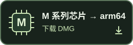
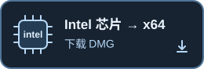

# Peek

自备 **OpenAI API 密钥**，ChatGPT 会员不能代替。选任务，开启音频。Ctrl+回车提问／切题；Shift 点击。Ctrl+⌫ 隐藏／回来；菜单栏退出。

苹果菜单→关于本机：看芯片／处理器，别按年份选。

**未签名、未公证。** 确认来源后，先打开一次，再到「系统设置→隐私与安全性→仍要打开」。[步骤](GUIDE.md#首次打开)

共享不保证隐藏。[说明](GUIDE.md) · [限制](HONESTY.md)
